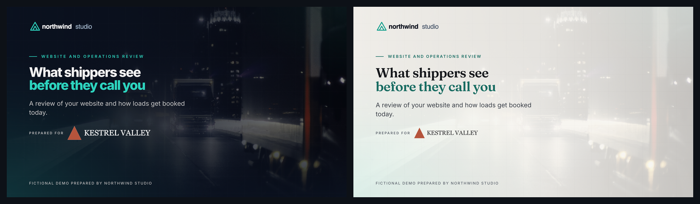
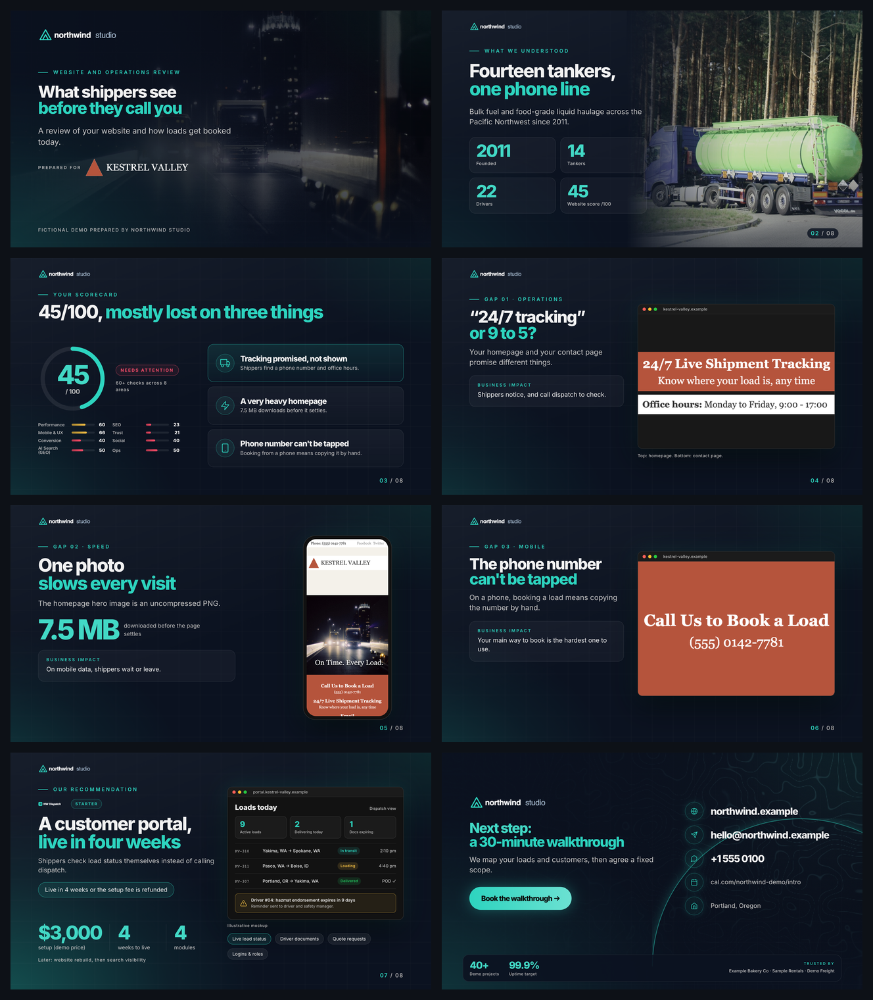
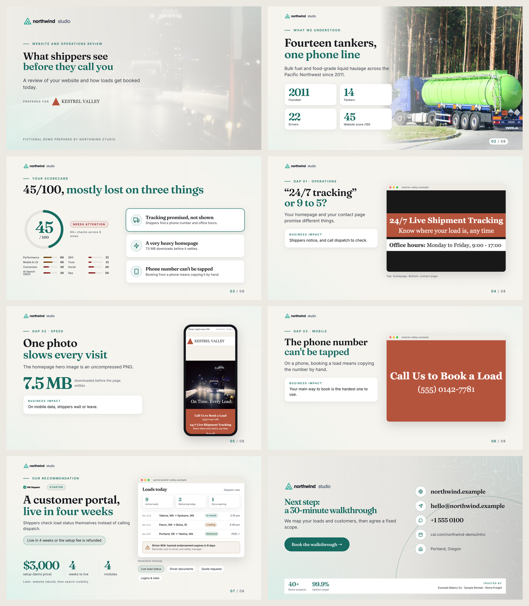

# pitch-audit: website audit to pitch deck PDF

[](https://github.com/webxlr8/pitch-audit/actions/workflows/ci.yml)
[](LICENSE)
[](#install)
[](docs/scoring.md)

A Claude Code skill for agencies and freelancers. Give it a prospect's website and it produces a short pitch deck PDF in your brand: what is wrong with their site, shown with screenshots from their own pages, and the one thing you would fix first.



The demo above is fictional: "Northwind Studio" pitching "Kestrel Valley Haulage". The prospect's deliberately flawed website ships in [`examples/demo-site/`](examples/demo-site/), so you can reproduce every slide.

## What you get for each prospect

1. A website audit: page speed (Lighthouse), SEO basics, mobile usability, security headers and certificates, analytics, conversion paths, social links, AI-search signals, and signs that orders still run on phone calls or spreadsheets.
2. A score out of 100 across 8 categories, with each problem mapped to one of your services or products.
3. An 8-slide PDF that uses their own logo, their own photos, their page-load filmstrip and screenshots of their pages as evidence.
4. Sales notes for you: talking points, likely objections, a follow-up email and a WhatsApp opener.

## How it keeps the deck credible

- Every number on a slide has to appear in the audit, your research notes or your company profile. The build fails if one does not.
- Prices, guarantees and client results only appear if you have written them into your profile.
- The deck copy is checked for stock phrases ("unlock", "seamless", "growth opportunities"), em dashes, Title Case headlines and the same headline shape repeated slide after slide.
- Text contrast is measured on the rendered pages against WCAG 2.2 AA, including text over photos.

## Why the PDF opens correctly on phones

Apple's PDF engine, which WhatsApp, iPhone and Apple Mail use, drops parts of normal browser-printed PDFs: photo fades, masks and shadows go missing. So each page is saved as one high-resolution image, with an invisible text layer on top (searchable, copyable) and real links. The build renders every page in Apple PDFKit, PDFium (Chrome, Android, Gmail) and poppler, and compares them with the original design.

## Install

As a Claude Code plugin:
```
/plugin marketplace add webxlr8/pitch-audit
/plugin install pitch-audit@pitch-audit
```
Or copy `skills/pitch-audit` into your project's `.claude/skills/`.

Check your machine and run the demo:
```bash
pip install -r skills/pitch-audit/requirements.txt
python3 skills/pitch-audit/scripts/doctor.py
python3 examples/run_demo.py          # writes examples/demo-output.pdf
```

## Use it

In Claude Code, from the folder where you keep your clients:
```
/pitch-audit:pitch-audit set up my company from https://your-company.com
/pitch-audit:pitch-audit pitch https://prospect.com
```
Setup reads your website and drafts your profile: logo, brand colour, fonts, contact details and services. You confirm the offers and any claims before they are used. For a list of leads, give it a CSV of names and URLs and it ranks them by how much there is to fix and how well they fit what you sell.

## Two looks

| Neon Studio (dark) | Editorial (light) |
|---|---|
|  |  |
| Tech, logistics, SaaS | Hospitality, food, professional services, traditional businesses |

Both use your colours, fonts and logo. Adding a style is a CSS file; see [docs/styles.md](docs/styles.md).

## Images

The deck prefers images in this order: the prospect's own logo and photos, then real data shown as pictures (load filmstrip, evidence screenshots), then free Unsplash or Pexels photos, then generated on-brand backgrounds. It never generates fake photos of the prospect's business.

## Docs

- [Company profile](docs/profile.md): what goes in `pitch-profile/` and how to point it at your own brand files
- [Styles and themes](docs/styles.md)
- [Scoring](docs/scoring.md): the rubric and how to tune it
- [Responsible use](docs/ethics.md)
- [Contributing](CONTRIBUTING.md) and [changelog](CHANGELOG.md)

## Requirements

Python 3.9+, Google Chrome or Playwright's Chromium, Node.js (for Lighthouse) and poppler. On macOS the Apple PDFKit check runs too. A `Dockerfile` is included. Optional keys: `PSI_API_KEY`, `UNSPLASH_ACCESS_KEY`, `PEXELS_API_KEY`.

## License

MIT. Built by [WebXLR8](https://webxlr8.com).
